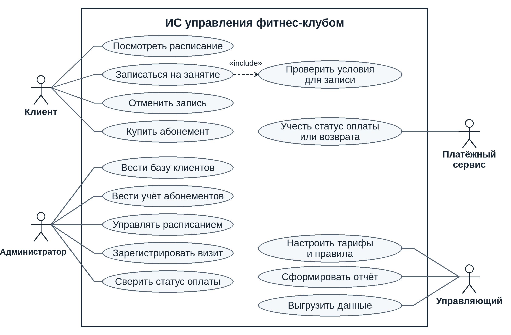
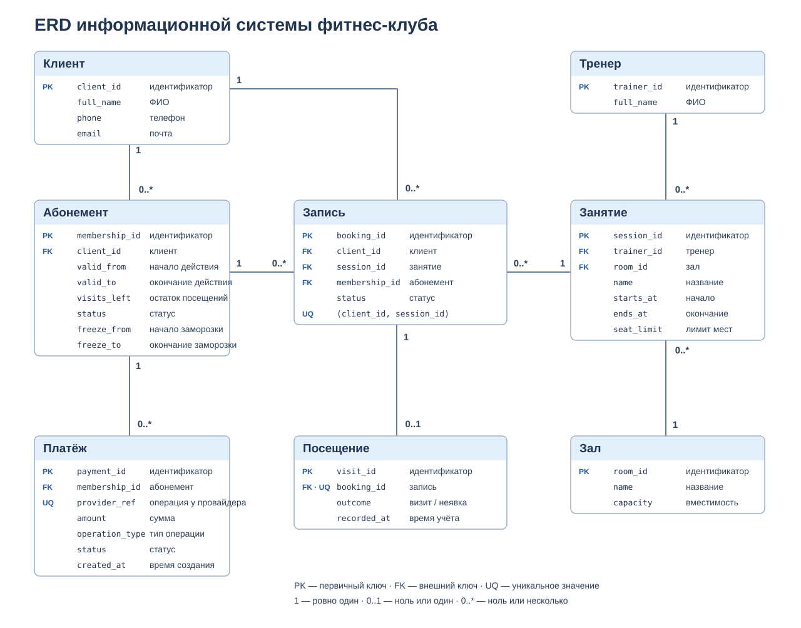
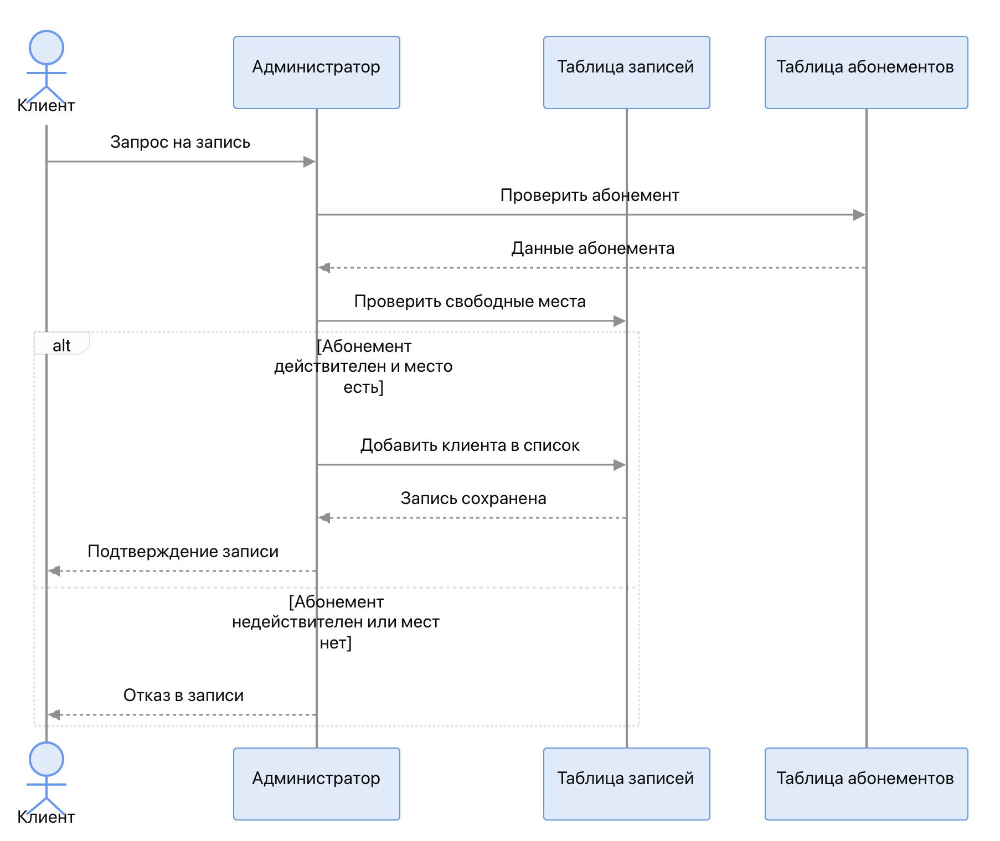
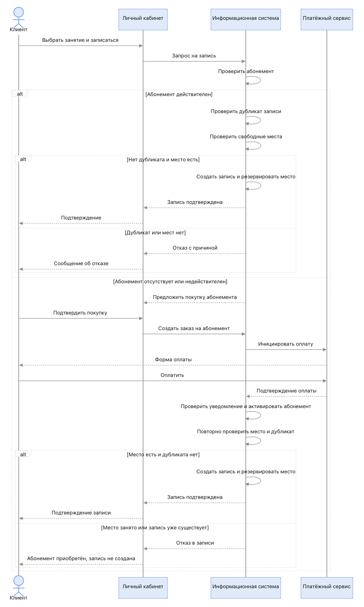
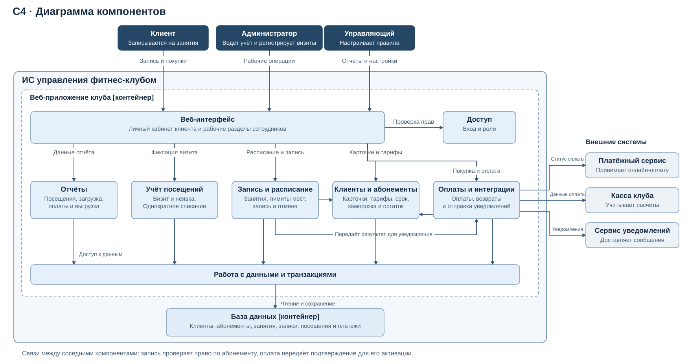
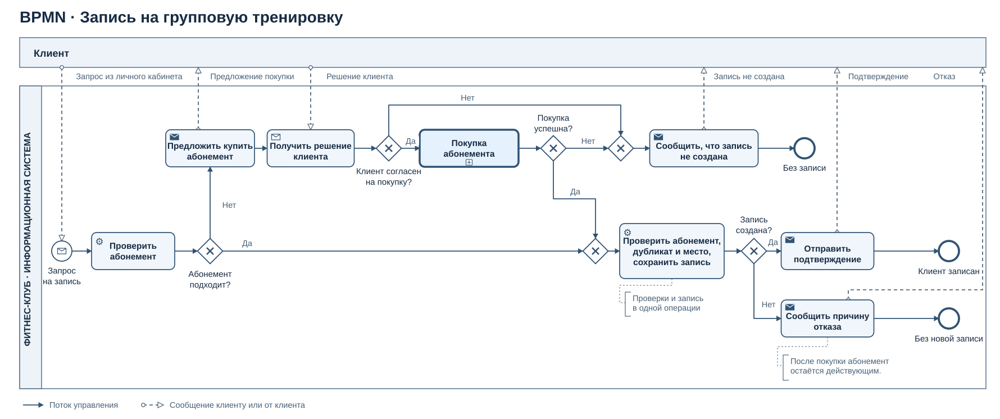

# Практическая работа № 4

**Дисциплина** — «Проектирование информационных систем»  
**Тема** — «Описание информационной системы с помощью различных нотаций»  
**Вариант 11** — управление фитнес-клубом  
**Группы** — К3340 и К3341  
**Выполнили** — Кирилл Кочкин, Никита Моломожнов, Максим Забродин и Михаил Зимин  
**Преподаватель** — Алексей Валентинович Духанов  
**Университет ИТМО, Санкт-Петербург, 2026**

## 1. Диаграмма вариантов использования UML

Цель работы — описать информационную систему фитнес-клуба с помощью UML, ERD и C4 и уточнить BPMN процесса записи. За основу взята концепция внедрения готовой отраслевой системы из [работы № 2](https://github.com/camperfail86/fitness-itmo-poject/blob/main/fitness-club%207/report.md).

На рисунке 1 показаны действия клиента, администратора, управляющего и внешнего платёжного сервиса.

*Рисунок 1 — UML-диаграмма вариантов использования ИС фитнес-клуба.*

Клиент записывается из личного кабинета. Связь `«include»` показывает, что при записи система обязательно проверяет абонемент, наличие места и отсутствие повторной записи. ИС выполняет проверки и резервирует место в одной операции.

| Код | Требование | Как отражено в модели |
| --- | --- | --- |
| F1 | База клиентов | Администратор ведёт карточки с контактами и историей операций. |
| F2 | Учёт абонементов | Администратор ведёт учёт срока действия, остатка посещений и заморозки. |
| F3 | Расписание | Администратор назначает тренера, зал и лимит мест. ИС выявляет пересечения. |
| F4 | Запись и отмена | Клиент записывается на занятие и отменяет запись. При отмене до начала место освобождается без списания посещения. |
| F5 | Посещения | Администратор регистрирует визит. ИС списывает посещение один раз при визите или по окончании занятия при неявке. |
| F6 | Оплаты и возвраты | ИС учитывает статусы от платёжного сервиса. Администратор сверяет спорные оплаты. |
| F7 | Отчёты и выгрузка | Управляющий формирует отчёты по визитам, загрузке и оплатам и выгружает данные. |

## 2. ERD и описание данных

*Рисунок 2 — ERD информационной системы фитнес-клуба.*

### 2.1. Краткое описание модели

Диаграмма показывает логическую модель данных фитнес-клуба. PK обозначает первичный ключ сущности, FK — ссылку на другую сущность, UQ — ограничение уникальности. Обозначения `1`, `0..1` и `0..*` показывают, сколько экземпляров сущности может быть связано с одним экземпляром на другом конце линии.

- **Клиент и абонемент.** У клиента может быть несколько абонементов. По каждому хранятся срок действия, статус, остаток посещений и даты текущей или запланированной заморозки.
- **Занятие, тренер и зал.** У каждого занятия есть один тренер и один зал. Для занятия задаются время начала и окончания и лимит мест. Система проверяет, что занятия одного тренера или в одном зале не пересекаются, а лимит мест укладывается во вместимость зала.
- **Запись и посещение.** Запись связывает клиента с конкретным занятием и абонементом, по которому оно будет списано. Система проверяет, что абонемент принадлежит этому клиенту. У записи может быть один учтённый результат, визит или неявка. До обработки результата посещение отсутствует.
- **Платёж.** Абонемент может быть связан с несколькими платёжными операциями. По каждой хранятся тип (оплата или возврат), сумма, статус, время создания и идентификатор операции у провайдера после его получения. При онлайн-покупке абонемент имеет статус «ожидает оплаты» до подтверждения успешной операции. Уникальный идентификатор провайдера позволяет обработать повторное уведомление как обновление той же операции.

**Ограничения записи и списания**

1. Для пары `(client_id, session_id)` действует ограничение уникальности. При повторной записи после отмены система обновляет существующую запись, если занятие ещё не началось и условия записи выполняются.
2. Система проверяет срок действия и заморозку абонемента, доступные посещения, отсутствие подтверждённой записи и наличие места. Проверки и сохранение записи выполняются одной операцией, поэтому последнее место получает только один клиент. Для проверки доступных посещений из остатка вычитаются подтверждённые записи по этому абонементу, по которым результат ещё не обработан.
3. Фиксация визита или неявки и уменьшение остатка на одно посещение выполняются одной операцией. Уникальный `booking_id` у посещения защищает от повторной обработки результата. Неявка фиксируется после окончания занятия. При отмене до начала место освобождается, а остаток не меняется.

## 3. Диаграммы последовательности UML

Рассматриваемый процесс — запись клиента на групповую тренировку.

### 3.1. Текущий процесс AS-IS

*Рисунок 3 — Запись на групповую тренировку до внедрения ИС.*

В текущем процессе клиент обращается к администратору по телефону или через сообщения, чтобы записаться на групповую тренировку. Администратор вручную проверяет срок действия и остаток посещений абонемента, а также наличие свободных мест в таблице расписания. Если условия выполняются, администратор вносит клиента в список участников и отправляет подтверждение. В противном случае клиент получает отказ. Процесс зависит от доступности администратора и корректности ведения таблиц, что может приводить к ошибкам при проверке абонементов и количества свободных мест.

### 3.2. Целевой процесс TO-BE

*Рисунок 4 — Запись на групповую тренировку после внедрения ИС.*

В целевом процессе клиент самостоятельно выбирает групповую тренировку в личном кабинете и отправляет запрос на запись. Информационная система автоматически проверяет действительность абонемента, наличие повторной записи и свободных мест. При выполнении всех условий запись создаётся, а место резервируется в рамках одной операции, после чего клиент получает подтверждение.

Если абонемент отсутствует или недействителен, система предлагает его приобрести. После подтверждения оплаты абонемент активируется, а система повторно проверяет наличие свободных мест и отсутствие дублирующей записи. Это необходимо, поскольку во время оплаты место может быть занято другим клиентом. Если условия записи не выполняются, клиент получает отказ с указанием причины. Автоматизация сокращает участие администратора и снижает риск ошибок при учёте записей.

### 3.3. Сравнение процессов

| Критерий | AS-IS | TO-BE |
| --- | --- | --- |
| Канал записи | Телефон или сообщения администратору | Личный кабинет клиента |
| Проверка абонемента и мест | Вручную по таблицам | Автоматически информационной системой |
| Подтверждение или отказ | Администратор сообщает клиенту | Система автоматически отправляет результат |
| Роль администратора | Обрабатывает каждую запись | Контролирует расписание и нестандартные ситуации |

В результате перехода от AS-IS к TO-BE процесс записи становится автоматизированным и доступным клиенту без обращения к администратору. Проверки абонемента, повторной записи и вместимости выполняются информационной системой, что снижает вероятность ошибок и превышения лимита участников. Дополнительно предусмотрена покупка абонемента онлайн и повторная проверка свободных мест после оплаты. Администратор переходит от обработки каждой заявки к контролю расписания и решению нестандартных ситуаций.

## 4. Архитектура по модели C4

На рисунке 5 показан компонентный уровень C4 для веб-приложения клуба. Схема отражает логическую структуру готовой отраслевой системы, выбранной в разделе 5.1 работы №2. Состав компонентов определён по требованиям F1–F7 и сценарию записи.

*Рисунок 5 - Основные компоненты информационной системы фитнес-клуба.*

### 4.1. Описание компонентов

В границу системы входят веб-приложение и общая база данных. Компоненты рисунка 5 относятся к веб-приложению. Через его интерфейс клиент работает в личном кабинете, администратор ведёт учёт и регистрирует визиты, а управляющий настраивает правила и получает отчёты.

| Компонент | Назначение |
| --- | --- |
| Веб-интерфейс | Показывает расписание и результаты операций. Принимает запросы клиента и сотрудников. |
| Доступ | Проверяет вход и права клиента, администратора и управляющего. |
| Клиенты и абонементы | Ведёт карточки клиентов и тарифы. Хранит срок, состояние заморозки и остаток посещений. Активирует абонемент после подтверждения оплаты. |
| Запись и расписание | Ведёт расписание с тренерами, залами и лимитами. Выявляет пересечения занятий. Проверяет право по абонементу, отсутствие дубликата и наличие места. Создаёт или отменяет запись. |
| Учёт посещений | Учитывает визит или неявку. Сохраняет результат и однократно списывает посещение в одной операции. |
| Оплаты и интеграции | Ведёт оплаты и возвраты. Получает статусы операций от платёжного сервиса, передаёт сведения в кассу и отправляет сообщения через сервис уведомлений. |
| Отчёты | Формирует отчёты по визитам, загрузке и оплатам. Готовит выгрузки для управляющего. |
| Работа с данными и транзакциями | Обеспечивает чтение и сохранение данных по модели раздела 2. Поддерживает единые операции записи и списания. |

При запросе из личного кабинета компонент записи получает сведения об абонементе и проверяет условия. Проверки и резервирование выполняются в одной операции, чтобы два клиента не заняли последнее место. Если нужен новый абонемент, компонент оплат получает подтверждение от платёжного сервиса и передаёт его для активации абонемента. После активации модуль записи проверяет условия повторно.

Платёжный сервис, касса и сервис уведомлений находятся за границей ИС. Система контроля доступа к залам отнесена в работе №2 к последующей интеграции. На первом этапе визит отмечает администратор.

## 5. Обновление BPMN процесса записи

За основу взята первая диаграмма из раздела 5.3 работы № 2. Процесс начинается с запроса авторизованного клиента из личного кабинета и завершается сообщением о результате. На рисунке 6 клиент показан отдельным участником. Пунктирные стрелки обозначают сообщения, сплошные - порядок выполнения задач внутри фитнес-клуба.

*Рисунок 6 - Обновлённый процесс записи на групповую тренировку.*

Если подходящего абонемента нет, ИС предлагает его купить и получает решение клиента. При согласии вызывается процесс покупки из работы №2. Если клиент отказался или покупка не подтверждена, ИС сообщает, что запись не создана.

При подходящем абонементе и после подтверждённой покупки выполняется общая операция записи. ИС проверяет срок и заморозку абонемента, доступный остаток посещений, отсутствие подтверждённой записи того же клиента и наличие места. При успехе система сохраняет запись и резервирует место. При повторной записи после отмены ИС обновляет существующую запись. Если одно из условий не выполнено, система сообщает причину. Если запись не состоялась уже после покупки, абонемент остаётся действующим.

### 5.1. Изменения относительно работы № 2

| Что уточнили | Как показано в BPMN | Основание |
| --- | --- | --- |
| Решение клиента о покупке | Между проверкой абонемента и вызовом покупки добавлены предложение, получение ответа и развилка «Клиент согласен на покупку?». | Последовательность TO-BE в разделе 3.2 показывает предложение и подтверждение клиента. |
| Состав единой операции записи | В задаче явно указаны абонемент, дубликат и место. Обе ветки входят в неё через общий шлюз. Добавлена пометка о выполнении проверок и сохранения в одной операции. | Требование F4, ограничения ERD и последовательность TO-BE. |
| Ответ клиенту при отказе от покупки или неподтверждённой оплате | Обе ветки приходят к задаче «Сообщить, что запись не создана». В исходной схеме ветка неуспешной покупки сразу завершалась. | В целевом процессе результат запроса сообщает ИС. |
| Статус абонемента при отказе в записи после покупки | У задачи отправки отказа добавлена пометка, что после покупки абонемент остаётся действующим. | В последовательности TO-BE активация абонемента предшествует итоговой проверке записи. |

Вызов процесса покупки и повторная проверка условий записи после оплаты сохранены из работы №2. [Редактируемая модель BPMN](assets/booking-to-be.bpmn) также содержит исходные диаграммы покупки абонемента и регистрации визита.

## Заключение

В работе описаны функции ИС фитнес-клуба, структура её данных и связи между компонентами. Сравнение сценариев записи показало, что после внедрения ИС клиент сможет записываться через личный кабинет, а проверки абонемента и мест перейдут от администратора к системе. В обновлённой BPMN уточнены решение клиента о покупке, условия создания записи и сообщения для случаев, когда запись не состоялась.

## Источники

1. Методические указания к заданию № 4 «Описание информационной системы с помощью различных нотаций».
2. [Практическая работа № 2 «Концепция информационной системы управления фитнес-клубом»](https://github.com/camperfail86/fitness-itmo-poject/blob/main/fitness-club%207/report.md).
